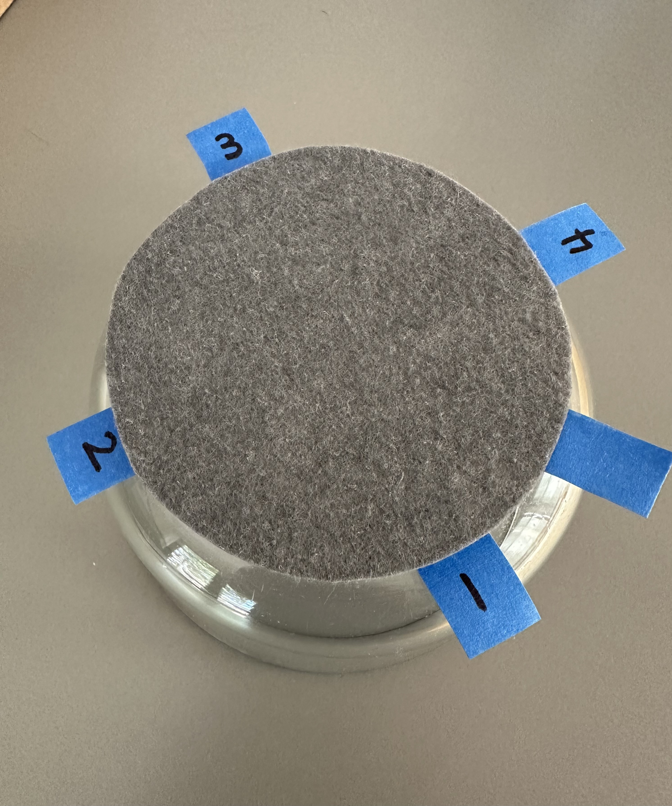
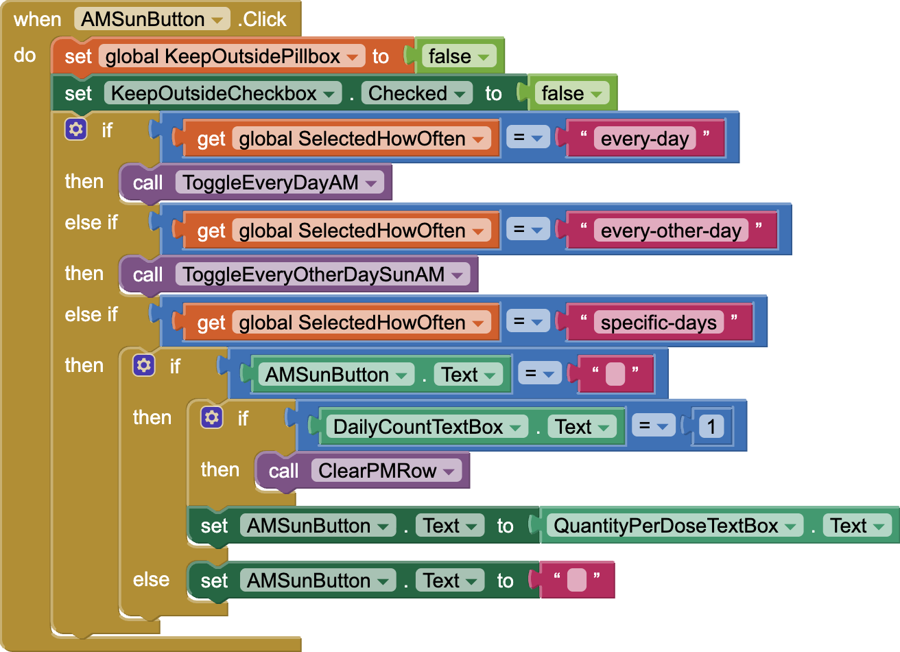
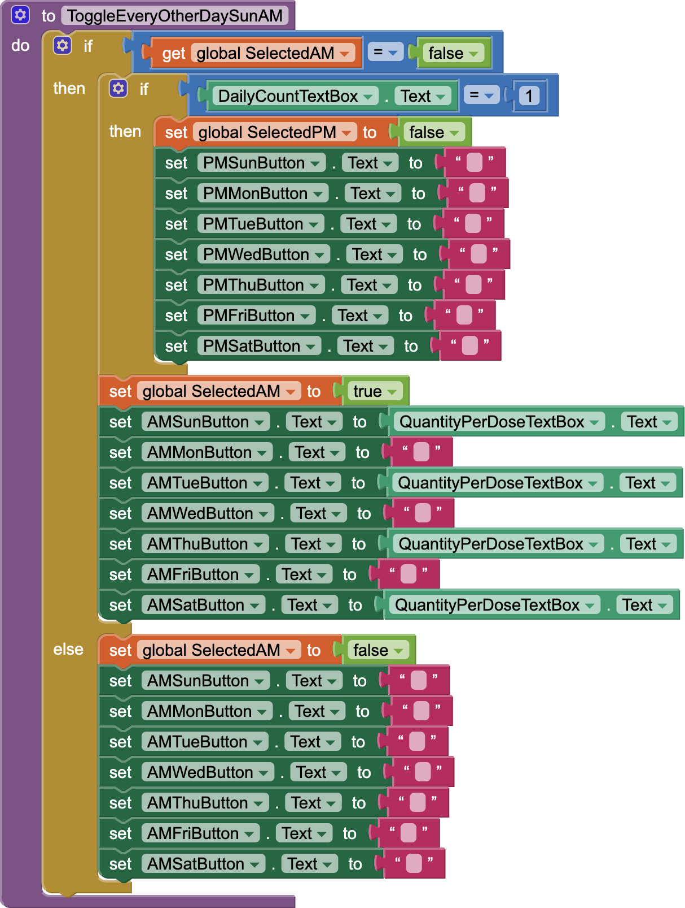
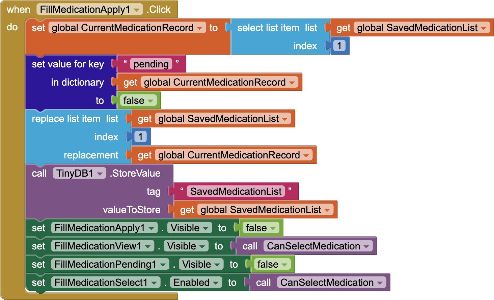
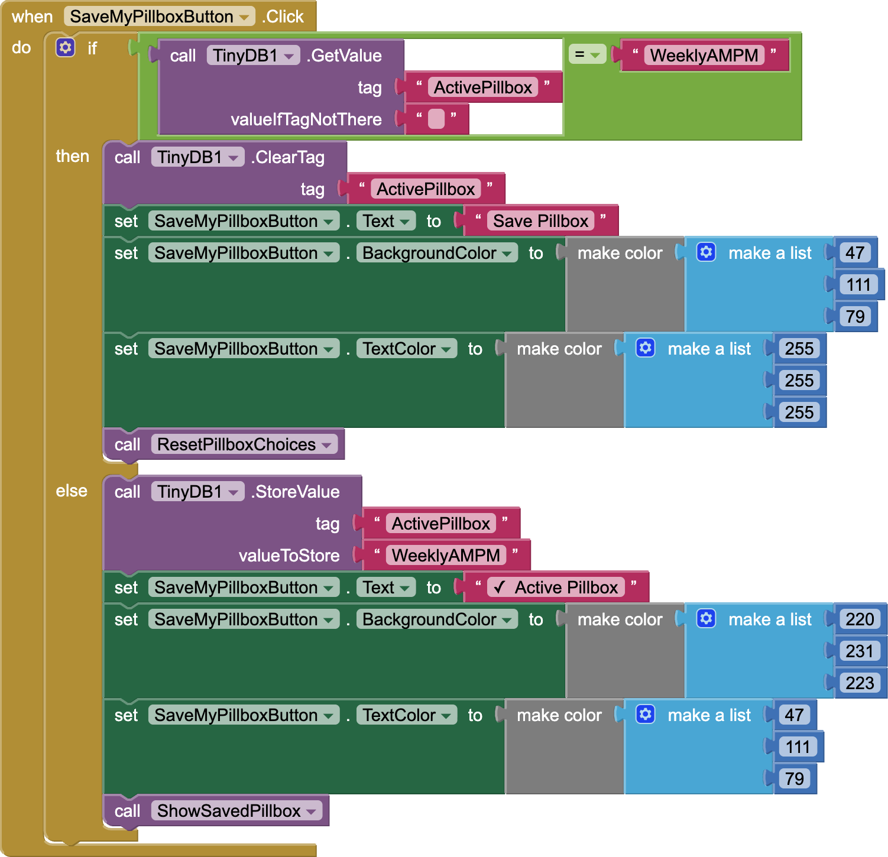
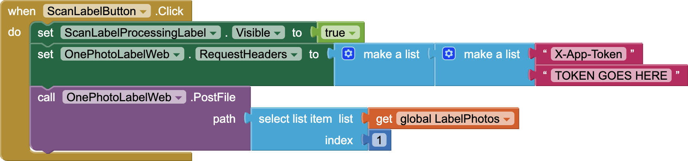

# PillboxSnap

PillboxSnap is an app that helps older adults fill and check their own pillbox, using photos of their own pills.

Built for the 2026 Congressional App Challenge (California's 15th District).

## Why I built it
My grandfather is 90 and still fills his own pillbox every week. Medication labels can be hard to read, and the same instruction can be written many different ways. I wanted to make filling and checking a pillbox simpler and more visual.

## What it does
- **Profile:** set up the app to match your own pillbox (weekly, AM and PM).
- **Add a medication:** take photos of the bottle and the pill. A rotating disc I designed helps capture the whole label and position the pill. Scan Label reads the label and fills in the details. You review everything before saving.
- **Smart selections:** tap one compartment, and the app uses the dosing schedule to fill in the rest (every day, every other day, or specific days). A once-a-day medication can go in the morning or the evening, but not both.
- **Pending and Apply:** new medications stay pending until you apply them, so nothing changes in your pillbox until you're ready.
- **Fill Compartments:** select a medication to see exactly where it goes and how many.
- **See Compartments:** select a day to see a photo of every pill that belongs in each compartment.
- **The capture disc I designed**

## How it's built
| Tool | Language | What it does |
|---|---|---|
| MIT App Inventor | Block-based code | The app: screens, pillbox logic, smart selections, and saving data on the iPad |
| Cloudflare Workers | JavaScript | Crops pill photos and securely connects the app to Claude |
| Claude API (Anthropic) | n/a (called by the Worker) | Reads the label photos and returns the medication details as structured fields |

## Block code examples
Each of the 14 compartment buttons uses the same pattern, shown here for Sunday AM.

**Smart selection (Sunday AM button)**

**Every other day helper**

**Applying a pending medication**

**Saving the pillbox setup**

**Sending a label photo to be read** (the app token is removed for security)

## Files
- `worker.js`: the Cloudflare Worker that sends label photos to Claude and returns structured fields
- `pill-crop-worker.js`: the Cloudflare Worker that crops the center of each pill photo, where the disc positions the pill
- `*.png`: screenshots of key App Inventor blocks
- `PillboxSnap_Public.aia`: the full App Inventor project (app token removed). It still includes a few early test components that are no longer used.

## Security
The Claude API key and app token are stored as Cloudflare secrets, not in the code. The label Worker also has a daily usage limit.

## Demo data
The demo uses fictional prescription labels. Flumoride is a made-up medication. PillboxSnap is a visual guide, not medical advice.

## Known issues
- **Capitalization of one demo name:** Screen1 and MedicationDetailScreen include a one-time block that corrects the capitalization of one demo medication name (AMOXICILLIN → Amoxicillin). The label reader returns names exactly as printed, and some labels print names in all caps. Updating the prompt to normalize capitalization is a planned fix.
- **Four medications per compartment:** In See Compartments, each AM or PM compartment shows up to four medications, because the screen uses a fixed set of rows. A list that grows with the data would remove this limit.
- **Scan Label in the public project:** The app token is removed from `PillboxSnap_public.aia`, so Scan Label won't connect to the Worker if the project is run as is.

## AI use
I used AI tools (ChatGPT and Claude) as helpers during development. My full AI disclosure, including what I designed, coded, changed, and tested myself, is in my Congressional App Challenge submission.

Separately, Claude is part of the app itself: it reads label photos and returns the medication details.
